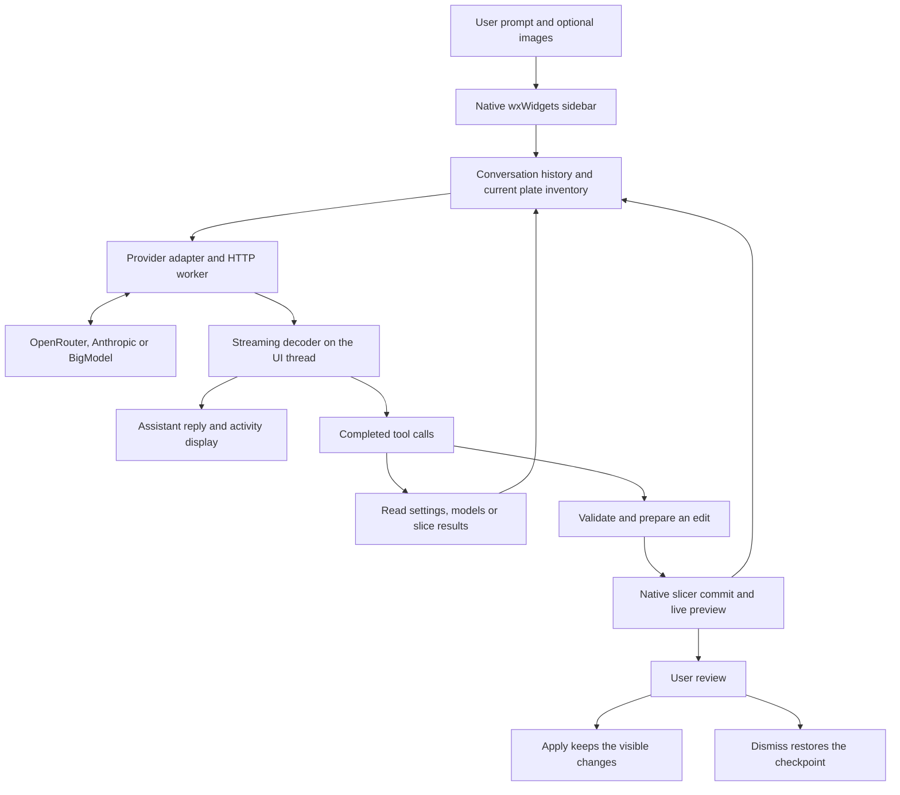

# AI assistant integration and architecture

Implementation reference for the `feature/ai-print-assistant` branch, updated 20 October 2026.

Snorca's AI assistant connects a native slicer sidebar to an external language model. The model interprets the user's request, reads application state through tools, and requests specific settings or model operations. Local C++ code validates those requests and performs the edits through the slicer's own configuration and geometry APIs.

Automatic edits appear immediately in the workspace as one cumulative live preview. **Apply changes** accepts the visible result; **Dismiss** restores the state from before the preview. The assistant can complete several dependent operations before the user makes that decision.

This guide explains the implementation for developers maintaining or extending the feature. The [assistant workflow and capability reference](AI-Print-Assistant.md) describes the user controls, supported operations and validation history.

For usage, benefits and possible future experiences, see the [Snorca AI assistant product guide](AI-Assistant-Product-Guide.md).

## Architecture overview

The integration uses C++17, wxWidgets, `nlohmann::json`, the existing libcurl-based `Http` wrapper, and native slicer libraries. It does not require a local LLM, a separate application server, an embedded browser, or an agent-framework dependency.

Here, **harness** means the application code that builds requests, exposes tools, runs their handlers, checks results and manages the conversation.



The model has access to the eight registered tools described below. It has no general shell, unrestricted filesystem access, or ability to call arbitrary C++ functions. Tool calls are structured JSON requests; successful local execution determines whether an operation actually happened.

### Source code map

Paths below are relative to the repository root.

| Component | Source | Responsibility |
| --- | --- | --- |
| Application integration | [MainFrame.cpp](../src/slic3r/GUI/MainFrame.cpp) | Opens, owns, hides and themes the sidebar alongside the workspace. |
| Sidebar and orchestration | [AIPrintAssistantDialog.cpp](../src/slic3r/GUI/AIPrintAssistantDialog.cpp) | Implements `AIPrintAssistantPanel`, chat history, request polling, tool dispatch, image preparation and preview controls. Despite the filename, the main interface is a docked panel. |
| Chat protocol | [AIPrintAssistantChat.cpp](../src/slic3r/Utils/AIPrintAssistantChat.cpp) | Defines the system prompt and tools, serializes provider messages and decodes streamed responses. |
| Provider utilities | [AIPrintAssistantProvider.cpp](../src/slic3r/Utils/AIPrintAssistantProvider.cpp) | Holds provider defaults, image validation and bounded error reporting. Also retains the non-streaming proposal adapters; the sidebar uses the chat adapter. |
| Network transport | [Http.cpp](../src/slic3r/Utils/Http.cpp) | Supplies asynchronous requests and `post_external`, which isolates external API transport from printer/account headers. |
| Settings logic | [AIPrintAssistant.cpp](../src/libslic3r/AIPrintAssistant.cpp) and [AIPrintAssistantCatalog.cpp](../src/libslic3r/AIPrintAssistantCatalog.cpp) | Capture context, discover settings, parse typed proposals and validate candidate configurations. |
| Model logic | [libslic3r/AIModelTools.cpp](../src/libslic3r/AIModelTools.cpp) | Defines operation schemas, prepares geometry/mixing edits on copies, fingerprints state and implements `LivePreview`. |
| Workspace adapter | [GUI/AIModelTools.cpp](../src/slic3r/GUI/AIModelTools.cpp) | Connects tools to `Plater`, plate state, native editors, presets, mixing and model commits. |
| Slice inspection | [AISliceTools.cpp](../src/libslic3r/AISliceTools.cpp) | Summarizes processed toolpaths and reads bounded excerpts of the current slice's G-code. |
| Reply formatting | [AIChatMarkdown.cpp](../src/slic3r/Utils/AIChatMarkdown.cpp) | Converts a Markdown subset to HTML supported by native `wxHtmlWindow` controls. |

## What happens during a request

1. **Capture the user turn.** `request_proposal()` collects the prompt and prepared images. It captures the active plate inventory and, when available, the current settings context. The inventory includes stable object and instance IDs, names, dimensions, positions and slice availability.
2. **Append context to history.** `chat_turn_message()` puts this application context into the new user message. The complete settings catalog and meshes are not automatically attached to every turn; the model requests additional settings or model information through tools.
3. **Build the provider request.** `make_chat_request()` combines the fixed system instructions, tool schemas, model ID and conversation history. Each subsequent model round includes the accumulated messages and tool results.
4. **Start the HTTP worker.** The network callbacks capture a shared `RequestResult` mailbox, rather than GUI or model pointers. A mutex protects the received response buffer; cancellation uses an atomic flag.
5. **Render streaming progress.** A wxWidgets timer polls the mailbox every 100 ms. `ChatStream` consumes only newly received bytes, assembles server-sent events, updates visible reply text and tracks tool-call fragments.
6. **Validate completion.** The harness waits for successful HTTP completion and a valid terminal stream state before retrieving tool calls. Incomplete JSON arguments, truncated responses and provider errors cannot trigger edits.
7. **Run tools sequentially.** `poll_request()` dispatches each completed call on the UI thread. A handler returns structured data or an error message. The transcript records the activity, and the provider receives the result associated with the original tool-call ID.
8. **Continue or finish.** If tools were called, the harness makes another model request. If the model returns a final reply without tools, the turn ends and any accumulated preview remains available for review.

The prompt tells the model to inspect actual state, use discovered schemas, refresh context after mutations and finish all requested automatic steps without waiting for Apply between them. Local checks enforce schemas, scopes and freshness independently of those instructions.

### Thread ownership

Network I/O runs asynchronously. Reading live application state, dispatching tools and committing changes happen on the UI thread. Geometry preparation also currently runs there, with a busy cursor for model operations. Large edits can therefore temporarily occupy the interface; heavy automatic geometry operations have a 500,000-triangle guard.

Stopping a request cancels network work and prevents unfinished calls from executing. Already completed preview steps remain available to inspect, accept, dismiss or continue in another message. A synchronous tool already running on the UI thread is not interrupted mid-operation.

## Providers and conversation state

| Provider | Endpoint | Default model in this implementation |
| --- | --- | --- |
| OpenRouter, the default | `https://openrouter.ai/api/v1/chat/completions` | `deepseek/deepseek-v4.1-flash-1017` |
| Direct Anthropic | `https://api.anthropic.com/v1/messages` | `claude-sonnet-5-5` |
| BigModel | `https://open.bigmodel.cn/api/paas/v4/chat/completions` | `glm-5.3-flash` |
| BigModel (Coding Plan) | `https://open.bigmodel.cn/api/coding/paas/v4/chat/completions` | `glm-5.3-flash` |

The model field is configurable. The chosen model must support tools and, when attachments are used, image input. These are application defaults, not a guarantee of a provider's future model availability.

OpenRouter and BigModel use function-tool schemas, bearer authentication, image data URLs and tool-role result messages. OpenRouter alone receives its `provider.require_parameters` routing option. The Anthropic adapter uses `input_schema`, `x-api-key`, base64 image blocks and `tool_result` blocks in user messages. It merges adjacent compatible messages as required by that protocol. All providers feed the same local tool handlers.

BigModel enables `tool_stream` and `thinking: {type: "enabled", clear_thinking: false}`. Its decoder joins streamed `reasoning_content` fragments and returns them unchanged in assistant history for tool continuations and later turns, separately from visible reply text. This follows BigModel's [thinking protocol](https://docs.bigmodel.cn/cn/guide/capabilities/thinking-mode) and [tool streaming format](https://docs.bigmodel.cn/cn/guide/capabilities/stream-tool). The retained non-streaming proposal adapter uses JSON-object mode with the proposal schema in the system message and local validation of the response.

Settings shows the selected endpoint. Standard API and Coding Plan routes are separate choices with separate account/key eligibility; switching does not silently fall back to a different billing route. Coding Plan access remains subject to the provider's [supported environments](https://docs.bigmodel.cn/cn/coding-plan/tool/others).

The system prompt and tool definitions stay fixed within a conversation. Changing application state is appended in later messages rather than rewriting earlier messages. This preserves the conversation prefix used by provider-signed reasoning metadata. The decoder retains continuation metadata in memory; the UI shows working status and action summaries, not private reasoning text.

Chat history, images and the API key are kept in panel memory. Hiding the sidebar preserves the conversation, while cancelling an active request. New chat clears the conversation and dismisses a pending preview before clearing it. Provider/model changes start a new conversation. There is no persisted chat archive or persistent API-key store in this implementation.

History is resent on subsequent requests. There is no automatic conversation summarization or token/cost meter yet, so long tool sequences and broad catalog queries increase input usage.

## Context and the tool interface

### Tool reference

| Tool | Input and result | Effect |
| --- | --- | --- |
| `get_print_context` | Optional `object_id`; returns current public settings, editable scope and a settings `context_id`. | Reads state. |
| `search_settings` | `query` and optional `object_id`; returns matching catalog entries with labels, descriptions, types, limits and values. An empty query lists the selected scope's full catalog. | Reads state. |
| `get_model_context` | No arguments; returns objects, parts, instances, plate membership, bounds, text and physical/mixed filament information, plus a model `context_id`. | Reads state. |
| `list_model_tools` | No arguments; returns operation parameter schemas and native editor availability. | Discovers capabilities. |
| `get_slice_context` | Optional `height_mm`, `radius_mm` and `max_moves`; returns the current plate's slice summary and optional height-band details. | Reads an existing slice. |
| `read_gcode` | `slice_id`, optional `start_line` and `line_count`; returns numbered text and pagination information. | Reads a bounded slice excerpt. |
| `propose_settings` | Fresh settings `context_id`, `object_id`, explanation and typed changes. | Validates and updates the live preview. |
| `propose_model_operation` | Fresh model `context_id`, operation name, target IDs and typed parameters. | Updates the live preview or offers an interactive workspace handoff. |

### Object targeting and freshness

Objects are addressed by stable slicer IDs rather than names or list positions. The active plate inventory accompanies every user turn, so a user does not need to select an object before asking for help. The settings tools infer a sole object when no ID is supplied. With multiple objects, they return a shared read-only overview until the model supplies a particular object's ID. Ambiguous user intent still requires clarification.

Settings context, model context and slice identity are separate. Their identifiers must not be interchanged. An operation must use the ID returned by the corresponding inspection tool, and dependent edits must obtain fresh context after a change. This prevents a request prepared against old geometry or configuration from being applied to a different state.

Model summaries expose dimensions and structure, but do not transmit triangle meshes. Visual evidence comes from explicitly attached images; the assistant does not automatically capture the viewport. The local geometry tools can still operate on the actual meshes held by the application.

## How settings edits work

The catalog comes from native `print_config_def` metadata and the slicer's scope option lists. It includes setting keys, labels, tooltips, categories, units, current values, enum choices, numeric ranges and array lengths. This avoids maintaining a separate handwritten list of hundreds of settings. Read-only fields, SLA settings, credential fields and internal preset bookkeeping are filtered out.

The user controls the writable scope with the chat dropdown:

| Scope | Configuration changed |
| --- | --- |
| Object | Sparse overrides on the target object. |
| Process | The currently edited global print/process preset. |
| Filament | The currently edited filament preset, not an arbitrary filament slot. |
| Printer | The currently edited printer preset. |

The model can inspect public values outside the selected scope, but cannot switch the scope itself. A request involving both object and filament settings therefore needs a manual scope change. Preset changes can affect multiple objects, and plate/object overrides may mask their effect.

`parse_proposal()` rejects unknown fields, duplicate keys and invalid types. `prepare_apply()` then checks the context identity and scope, preserves required vector lengths, and merges the proposed values into the existing configuration. It validates that complete candidate, including relevant dependencies such as Arachne-only options, before anything reaches the live configuration.

Object edits update `ModelObject::config` and refresh the native object settings UI. Preset edits are first validated in a copied `PresetBundle`, then applied through the appropriate native settings tab. If native normalization changes additional values outside the proposal, the commit rolls back and reports the dependency issue. Successful changes notify the plater and invalidate the previous slice through the normal update path.

For settings proposals, numbers and booleans retain their JSON types. A percent value is a number; a number-or-percent option accepts an absolute number or a string such as `"120%"`. Vector and point values are JSON-encoded strings, such as `"[215]"`. Model-operation parameters instead use ordinary JSON arrays. This distinction is part of the wire contract.

Settings mutations currently require a supported object context even for preset scopes. The object must have solid geometry and one instance. Solid multipart objects and negative volumes are supported, but settings/support modifiers, variable layer height, height-range/material overrides and most part-level overrides prevent automatic settings edits. Inspection remains available with the reason editing is unavailable. Model tools have their own eligibility checks and can support objects that settings mutation rejects.

## Model editing and color mixing

`model_tool_catalog()` defines named operations and their exact parameter schemas. `prepare_model_edit()` validates parameters and performs automatic operations on copies of the model and mixing manager. The GUI adapter checks that the workspace is ready, then commits the prepared result through native model, object-list, plate and configuration updates.

Automatic operations cover transforms, primitive creation, raised/engraved text, duplication/deletion/renaming, part types, filament assignment, triangle-based surface painting, splitting, booleans, simplification, plane cuts and mixed-filament creation/matching. Model replacement preserves project-level bookkeeping through the dedicated object-replacement path in [Model.cpp](../src/libslic3r/Model.cpp).

New standalone shapes default to the active plate's world-space XY center with their bottom on the bed. The host supplies the actual plate center, including offset plates; the model should omit an explicit position unless the user asked for one.

Text creation uses a bundled font and native emboss metadata, keeping it editable in the slicer's text tool. Automatic placement checks the target surface and planar footprint. Painting marks whole existing triangles using face normals and optional boxes. Curved text placement and brush-level painting remain interactive tasks. Mesh replacement operations such as booleans and simplification clear affected painting/text metadata.

Color mixing uses `MixedFilamentManager`, loaded compatible physical filaments and the native color-matching solver. Recipe percentages must total 100. The returned virtual-filament ID can be used in subsequent assignment or painting operations. Preview colors are approximate; gradients express blend percentages, not physical heights.

Native gizmos and workspace actions are a separate path. `open_editor` and `native_action` produce a visible **Open editor** or **Run workspace action** button. They require user interaction and cannot join a pending automatic preview. Native availability checks still apply, and opening an editor is not reported as a completed geometry edit.

## Live preview and rollback

The first successful automatic edit creates a `PreviewCheckpoint` containing the model, mixing recipes and edited process, filament and printer configurations. The application also creates one native Undo snapshot. Further automatic edits reuse that checkpoint and suppress extra snapshots for the sequence.

After every edit, `record_preview()` stores a new state fingerprint and returns a result such as `status: preview_updated`, `visible_in_slicer: true` and `committed: false`. Here, `committed: false` means the user has not accepted the preview; the live project already contains the visible edits.

| Action | Result |
| --- | --- |
| Another automatic tool call | Validates against current state and extends the same preview. |
| Apply changes | Verifies the fingerprint and accepts the visible state without executing the edits again. |
| Dismiss | Cancels an active request and restores the whole checkpoint. |
| Revert changes after Apply | Restores the checkpoint if later changes have not invalidated it. |
| Stop or hide the sidebar | Stops the request and preserves completed preview steps. |
| New chat | Dismisses a pending preview before clearing history; accepted edits remain. |

The preview fingerprint includes model content, mixing recipes, preset identities and configuration values. Its conflict check excludes selection and camera changes, so inspecting the preview does not block review. Individual model-operation contexts can still depend on selection. Unrelated manual edits after the preview cause a conflict rather than being silently overwritten by continuation or rollback.

Apply/Dismiss events are appended to the conversation so the model can distinguish a proposed result from an accepted or restored state. Native geometry Undo alone does not restore preset configurations and mixing state; the preview controls handle the complete checkpoint. Only the current checkpoint is retained, not an independent rollback record for every past reply.

Because the preview is actual project state, saving or exporting while it is pending includes the visible preview. Preset edits remain unsaved preset changes until saved through the normal slicer UI.

### Example of a dependent edit sequence

For “Make this cube 120 mm wide, put hello on the front and give it three walls,” with Object scope selected:

1. The model reads the plate/model context and discovers the transform and text schemas.
2. A resize operation is validated and previewed. The cube changes in the viewport.
3. The model reads fresh model context, then adds text using the resized face dimensions.
4. It reads fresh settings context for that object's ID, checks `wall_loops` and proposes a value of 3.
5. Local settings validation succeeds and extends the preview.
6. The final reply summarizes all three changes. Apply keeps them; Dismiss restores the original cube, lettering state and settings together.

The user then slices again to evaluate the new toolpaths. Neither the language model's reply nor a successful tool result establishes the quality of a physical print.

## Reading slices and G-code

The GUI adapter checks whether the active FFF plate has a completed, valid and loaded `GCodeProcessorResult`. It refuses stale data while slicing/model work is running or configuration updates are pending. A saved slice whose moves are not loaded produces a request to open Preview.

`get_slice_context` returns warnings, conflicts, outside-bed flags, time/material estimates and time by extrusion role. An optional height query adds speed, fan, nozzle-temperature, line-width, layer-height and volumetric-rate ranges, bounded move samples and the corresponding G-code line range.

`read_gcode` accepts the current `slice_id` and line numbers. The file path comes exclusively from the application's current slice result. It validates the file and line index, reports truncation and supplies pagination. It neither executes the text nor exposes a general file-reading tool.

A height window covers the plate's matching moves, including repeated heights in sequential printing. Samples are the first matching moves in G-code order, not a reconstruction or per-object attribution. The tools inspect planned output; they do not start a slice, submit a print, monitor the printer or capture an image.

## Images and external data

Attachments accept PNG/JPEG files. The application validates header dimensions before decoding, limits file size and pixel count, resizes to a maximum edge of 1568 pixels, flattens to RGB and re-encodes JPEG without original metadata. Prepared images remain in conversation history for follow-up requests.

Provider requests can contain chat messages, prepared image pixels, model/part names, lettering, public settings, mixing recipes, slice summaries and requested G-code excerpts. Public settings include custom G-code. Full meshes, original image filenames, the local slice path and the complete private configuration are not included as such; user-authored names, image content and G-code comments can still contain personal information.

`Http::post_external()` uses fixed provider endpoints, certificate/hostname verification, no redirects and no automatic slicer account/printer headers. The API key is supplied only in the authentication header. Provider errors are bounded and redacted rather than displayed as raw response dumps. Failed transfers retain the transport diagnostic (such as a timeout, DNS failure, TLS error or connection reset), with API keys, proxy URL credentials and image data redacted. A transport failure does not by itself establish a certificate problem.

Image text, settings and tool-returned G-code are described to the model as untrusted data. Local schemas, validators and the limited tool surface remain the enforcement boundary. Reply rendering escapes raw HTML, does not load remote Markdown images, and opens HTTP(S) links only when clicked.

### Current execution limits

| Limit | Current value |
| --- | --- |
| User prompt | 8,000 UTF-8 bytes per message |
| Model rounds | 32 per user turn |
| Tool calls | Up to 8 per model response; executed sequentially |
| Requested output budget | `max_tokens: 4096` for OpenRouter/Anthropic; `16384` for BigModel to leave room for reasoning |
| History | New turns stop at 450 stored messages; request builder caps history at 512 |
| Serialized request / streamed response | 32 MiB / 2 MiB |
| Network timeouts | 15 seconds to connect; 180 seconds per request |
| Image attachments | 4 per message; 20 MiB and 40 megapixels per input; 4 MiB base64 per prepared image |
| G-code excerpt | Up to 200 lines and 64 KiB; individual lines truncated at 2,048 bytes |
| Height query | Default radius 0.5 mm, maximum 20 mm; default 20 and maximum 80 sampled moves |
| Imported proposal | 64 KiB |

When a turn reaches its work limit, completed preview changes remain available. The user can continue in another message, accept the result or dismiss it.

## UI integration and rendering

`MainFrame::toggle_ai_print_assistant()` creates the sidebar lazily through `create_ai_print_assistant()` and adds it beside the workspace. The panel uses Orca's existing buttons, input controls, labels and light/dark colors. Its left edge resizes the panel; closing hides it.

One collapsed **Activity** group contains intermediate updates and tool calls for each user turn. Tool details are created when expanded, and the final assistant answer appears outside the group. Preview controls and interactive handoff buttons remain visible without opening the activity history.

Replies use a native `wxHtmlWindow` and `AIChatMarkdown`, supporting headings, emphasis, lists, quotes, code and pipe tables. Tables with more than two columns become labelled rows in narrow panels. Code wraps using the measured font width, and wheel events over reply text forward to the surrounding transcript. Scrolling away from the bottom pauses automatic following of new output. This is a Markdown subset; unsupported syntax such as strikethrough remains literal.

## Building testing and extending the feature

The core logic is compiled into `libslic3r`; the panel, adapters and formatting utilities are included by the slic3r GUI target. The feature reuses the project's existing dependencies. A separate worktree needs its own application build directory, but CMake can link compatible prebuilt dependency libraries from an existing installation.

From a configured worktree, the focused Windows Release commands are:

```powershell
cmake --build build --target ai_print_assistant_tests Snapmaker_Orca Snapmaker_Orca_app_gui --config Release
ctest --test-dir build -C Release -R "^ai_assistant:" --output-on-failure
```

The latest recorded run has 83 passing assistant tests. [test_ai_print_assistant.cpp](../tests/libslic3r/test_ai_print_assistant.cpp) covers settings, providers, streaming and conversation contracts; [test_ai_model_tools.cpp](../tests/libslic3r/test_ai_model_tools.cpp) covers geometry, mixing and preview transactions; [test_ai_slice_tools.cpp](../tests/libslic3r/test_ai_slice_tools.cpp) covers slice summaries and bounded G-code reads; [test_ai_chat_markdown.cpp](../tests/libslic3r/test_ai_chat_markdown.cpp) covers reply formatting. These tests use no provider credentials or network requests.

**Settings > Developer tools** supports context export and proposal import for offline checks. Exports include public context and schemas, with image hashes rather than pixels. Imported proposals pass through the same preview path as model tool calls, allowing viewport changes, Apply/Dismiss and rollback to be checked without an API request. UI smoke-test results and outstanding validation are recorded in the [workflow reference](AI-Print-Assistant.md#validation).

For extensions, keep responsibility in the layer that owns it:

- **A new model operation:** add its discoverable schema and copy-based preparation in `libslic3r/AIModelTools.cpp`, connect native workspace behavior in the GUI adapter when needed, and cover validation, stale context, commit and restoration.
- **A new read tool:** define the schema in the chat adapter, implement bounded data extraction, and add the UI-thread dispatch branch. Specify how freshness and missing data are represented.
- **A new provider:** extend provider configuration, message/image/tool-result conversion and streaming decoding. Keep the existing local tool semantics and add protocol tests before using live credentials.
- **Automatic scope selection:** change both scope-aware context capture/dispatch and the UI contract. Removing the prompt restriction alone is insufficient because local validators enforce the selected scope.
- **Token reporting:** retain usage fields from provider responses and aggregate them by request and turn. The current history-length and byte limits do not measure billed tokens.

The central maintenance rule is to preserve agreement between the tool schema, the local validator, the resulting slicer state and the result sent back to the model. A tool result should report exactly what happened, including whether the result is a pending preview or still requires user interaction.
