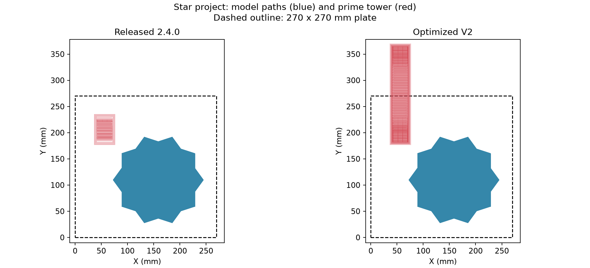
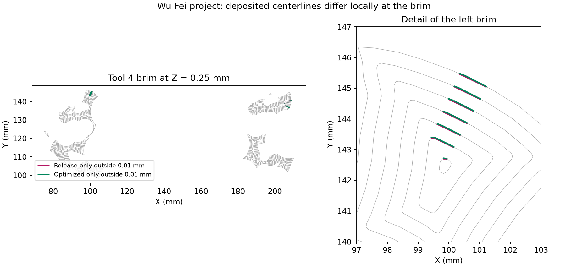
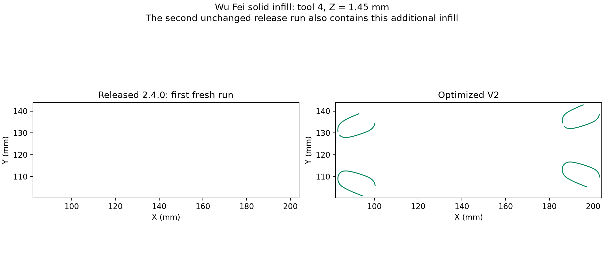

# Slicing regression comparison with released Snapmaker Orca 2.4.0

The optimized `proposal_UI_changes_GPU_Accelerate_V2` branch is **not yet equivalent to released 2.4.0 across this corpus**. Both builds generate G-code for all six supplied projects, although V2 reports an off-plate path on the star project. Two produce identical executable G-code, one has identical deposited segments with travel/retraction differences, two have small deposited-path differences, and the star project has a major Local-Z scheduling and prime-tower difference. An additional strict painting-preparation check also fails on one project. Repeated fresh launches show that released 2.4.0 itself can vary in its internal solid infill, so a single baseline run is insufficient.

This comparison was performed on 22 October 2026 against production commit `cb2598dc302823ef6e999dc6ec9a61e35bb499f3`. No production slicing code was changed during the investigation. The test tools, evidence summary and figures accompany this report.

## Inputs and comparison method

Inputs are the six original projects in `C:\Users\radug\Downloads\用户反馈有问题模型(混色算法导致)`. Their SHA-256 hashes were recorded before testing and verified afterwards. The reference is the actual portable executable in `C:\Users\radug\Downloads\Snapmaker_Orca_Windows_V2.4.0_portable\Snapmaker_Orca_Windows_V2.4.0_portable`, without patches or a replacement DLL. The optimized executable is `build-dev-release/src/Release/snapmaker-orca.exe`, built with Vulkan support.

Each build used its own isolated configuration directory. Projects were opened as projects in the GUI, retaining their embedded plate, object, painting and process settings; they were not reimported as bare meshes. Completed plate G-code was copied from the temporary output owned by the relevant test process. The principal six-model comparison uses the optimized CPU path; additional GPU and optimization-disabled controls are described below.

GUI comparisons are necessary here. The released CLI crashes before slicing on the tested launch path, in GUI-dependent filament lookup. The current CLI also resolves these projects' filament settings differently from the GUI; for example, per-filament flow/speed arrays differ. Its load of `对不齐.3mf` crashes while both GUIs slice that project successfully. Those preliminary CLI outputs are excluded from the equivalence verdicts. Slicing wall times from these manually driven GUI runs are not a controlled performance benchmark.

The auditor compares several distinct properties:

1. Executable command hashes after removing comments, including travel, retractions, temperatures and tool changes. Identical hashes mean identical command text in the same order; project metadata can still differ.
2. Tool-change sequence and nominal layer sequence, plus physical extrusion Z coordinates. Matching nominal layers alone does not establish matching Local-Z sublayers.
3. Positive XY extrusion segments grouped by physical tool, physical Z, role, layer height and extrusion width. Segment comparison retains extrusion amount and feed rate but permits reversal and reordering. Numeric keys are rounded to six decimal places.
4. For changed groups, bidirectional centerline coverage at a diagnostic tolerance of **0.01 mm**, preserving tool, physical Z, role and layer height. Width differences remain visible in the strict comparison; widths are merged only for spatial coverage so a tiny width-label change does not appear as an entire missing path.
5. Effective configuration differences, filament consumption and estimated printing time. These help explain changes; equal totals alone are not a pass.

Centerline coverage is not a simulation of bead volume, travel collisions, pressure, cooling or printer firmware. Direction/order-independent equality does not validate seam location or scheduling. The parser handles modal XYZ/E and XY I/J arcs, and rejects several unsupported coordinate modes; it does not execute printer macros. The supplied files use the supported path format. Physical printer validation remains necessary for scheduling or flow changes.

## Results for the six projects

The times below are **estimated printing times from G-code**, not slicing durations. Tool-change counts use the G-code footer; the GUI can show one more because it includes the initial tool selection. The table describes the initial six-project series within each isolated application session. The later fresh-start controls for Wu Fei produce different results, documented below; both launch conditions matter.

| Project | Released 2.4.0 | Optimized V2 | Comparison |
| --- | --- | --- | --- |
| `02-脸(1).3mf` | 30.35 g; 1h 25m 54s | 30.35 g; 1h 25m 54s | One extra 0.064031 mm internal-solid-infill segment at Z 22.76 mm; otherwise deposited segments match. |
| `10+STAR+FIDGET+TOY+29+colors.3mf` | 116.54 g; 481 tool changes; 6h 06m 57s | 169.42 g; 2,146 tool changes; 17h 11m 22s | Major difference in Local-Z passes and prime tower. Optimized preview reports a path outside the plate. |
| `SlicerProblem_Painting.3mf` | 6.76 g; 17m 29s | 6.76 g; 17m 29s | Identical executable commands. |
| `TEST1.3mf` | 73.75 g; 331 tool changes; 3h 43m 05s | Same totals | All 505,611 deposited segments match with tool/Z/role/height/width/E/feed preserved. Travel, retraction and wipe commands differ locally. |
| `吴飞1.3mf` | 234.28 g; 1,106 tool changes; 13h 33m 39s | Same totals | Small changes in this series. Fresh starts expose variability in the released build's solid infill. Strict preparation validation also fails. |
| `对不齐.3mf` | 60.94 g; 2h 04m 46s | Same totals | Identical executable commands, including this project's multiple instances and physical filament profiles. |

### Star project changes behavior when loaded

The shared effective setting `dithering_local_z_direct_multicolor` changes from **0 in the release output to 1 in V2**. `PrintApply.cpp` forces it on whenever Local-Z mode is enabled, even when the project saved it as false. This behavior entered in commit `687192c8ce9`, *Port selected FullSpectrum color mixing and painting features*, rather than in the recent path-clipping performance work. `Tab.cpp` also enables the direct solver when SML is enabled.

That is a real compatibility change: an existing project no longer selects the same mixing solver. New defaults such as first-layer preservation and independent layer height must also be considered when separating feature changes from performance changes. The direct-solver switch is the strongest identified explanation for the different pass schedule; its individual numerical contribution has not been isolated with a solver-off build.

In a control run of the same optimized executable, `ORCA_LOCAL_Z_REUSE=0` and `ORCA_LOCAL_Z_CPU=legacy` disabled the new path reuse, clipping cache and spatial index. The resulting deposited segments and tool/layer sequences matched optimized defaults exactly. This rules out those particular optimizations as the cause of the larger tower on this input; it does not isolate every optimization in the branch.



The plot projects deposited paths into XY. Blue is the model and red is the prime tower; the dashed rectangle is the 270 × 270 mm plate. It does not compare the different sublayer schedules hidden by that projection. Two released-build runs produced identical executable commands, so the large difference is not explained by ordinary repeat variance.

### Face project has one extra short segment

At Z 22.76 mm, tool 1 gains a 0.064031 mm internal-solid-infill segment, consuming an additional 0.00236 mm of filament length. Other deposited segments and the tool/layer sequences match. Two release runs have identical executable commands. The discrepancy is tiny, but remains a recorded comparison finding rather than an assumed nondeterministic difference; two baseline runs do not exclude all possible variation.

### TEST1 preserves deposited paths but changes travel details

The segment multiset is identical, including extrusion amounts and feed rates. The command comparison contains seven removed and seven added command values, including travel endpoints at Z 23.45 mm and corresponding wipe/retraction amounts. For example, one travel endpoint changes from `X48.274 Y221.066` to `X48.021 Y220.878`. Matching deposited paths therefore does not imply identical travel or seam behavior.

### Wu Fei project has small path differences and baseline variability

Tool and nominal layer sequences match. Total positive XY deposition differs by only +0.00101 mm of filament length, but 73 strict metadata groups differ. After accounting for insignificant width-label changes in the spatial comparison, **9.748178 mm of release centerline and 9.771927 mm of optimized centerline lie outside the other result's 0.01 mm neighborhood**. These are lengths of affected paths, not displacement distances or missing material volume.

Almost all that difference is on the tool 4 brim at Z 0.25 mm. The remaining 0.002723 mm of added centerline outside tolerance is internal solid infill at Z 32.45 mm. Other changed groups match spatially within the diagnostic tolerance.



A second released-build run in the same application session changes 20 strict groups but has **zero centerline length outside the 0.01 mm tolerance** in either direction; its total positive-extrusion difference is +0.00007 mm. That repeat is evidence of some baseline ordering/rounding variability, but it does not explain away the measured brim difference.

Starting each executable directly with this project produces a different result from loading it after the other projects. In the first matched fresh-start comparison, released 2.4.0 reports **232.66 g and 13h 28m 10s**, while optimized V2 reports **233.20 g and 13h 30m 37s**. Tool-change and nominal layer sequences still match. V2 has **11,276 more internal-solid-infill segments, 5,410.753319 mm more path length and 182.40111 mm more filament extrusion in that role**. Other role totals are nearly unchanged in that pair.

Crucially, a **second fresh run of unchanged released 2.4.0 also produces 233.20 g and 13h 30m 37s**, adding that infill itself. The apparent +0.54 g difference therefore cannot be assigned to the optimizations. Release-to-release repeat variation includes a material deposition change, not just comments, travel order or decimal rounding. The underlying cause has not been isolated, and two fresh repeats are not a complete bound on baseline variability.

Against that second fresh release run, V2 differs by only -0.00179 mm of total positive XY filament extrusion, with the same tool/layer sequences, although 69 strict groups still differ. Equal mass estimates therefore must not be interpreted as exact path equality.



The plot uses the first fresh release run; the second release run also contains the additional infill. It illustrates why repeat controls are necessary, rather than proving a V2 defect.

The fresh optimized CPU and Vulkan runs have identical executable commands. The fresh Vulkan run with compact painted meshes disabled is also identical. Therefore neither enabling Vulkan nor compact painted meshes explains the infill difference in this control. The earlier in-session versus fresh-start optimized runs differ predominantly in supports and their brim, despite identical exported global settings. Both versions change with launch/loading conditions in this experiment; global G-code settings do not capture all possible application or per-object state.

### Strict painting preparation validation fails on Wu Fei

With `ORCA_PREP_VALIDATE_REUSE=1`, V2 stops during painting preparation with:

> Reused/compact painting selector changed ordered slab polygons

The check in `MultiMaterialSegmentation.cpp` compares the top/bottom polygons from reused/compact painted meshes with the legacy extraction path. Disabling only the `compact` preparation experiment allows the same strict check and the slice to complete. This narrows the diagnostic failure to compact painted meshes. The matched fresh-start runs with compact meshes on and off have identical executable G-code, so the failed intermediate check did not produce a final-output difference in that control. It does **not yet establish whether the slab difference is only polygon ordering or changes intermediate filled areas**. It remains a separate unresolved regression-check failure.

## Additional validation

The targeted test executable passed **47 cases and 462,293 assertions**, covering CPU slicing, Local-Z, Vulkan compute and the hardware paths. Hardware tests executed on the NVIDIA GeForce RTX 5060 Laptop GPU. The seven deterministic fixtures for the new G-code auditor also pass.

The star project was additionally sliced with `ORCA_LOCAL_Z_CLIP=validate` and `ORCA_SEAM_VISIBILITY=validate`, with CPU reference checks enabled. Its executable G-code matches the optimized CPU run exactly. That run's warning-level log does not contain dispatch counters, so it establishes end-to-end parity with those modes requested rather than quantifying which operations used the GPU.

On Wu Fei, with both normal and disabled compact meshes, Vulkan seam validation checked 163,298 and 160,510 samples for the two objects on the RTX 5060. Both report zero tolerance mismatches and a maximum error of `2.98023e-07`; many floating-point results differ at the bit level. The matched fresh CPU/GPU command streams are identical. No Local-Z clipping work was eligible in that ordinary slicing workload.

Successful unit and hardware tests are useful evidence, but they do not override the full-project differences and the failed preparation diagnostic above.

## Repeatable regression procedure

Keep two comparisons separate: **release compatibility**, where saved projects should preserve their old behavior unless migration is intentional, and **optimization equivalence**, where both executions have identical feature semantics and effective settings. A feature migration cannot be assessed as a pure speed optimization.

For future changes:

1. Preserve these six project hashes and released outputs as a regression corpus. Extend it with the earlier Local-Z stress models, single-color models, multiple plates, mixed perimeter/infill modes, modulation, support interfaces, variable layer height and degenerate painted meshes.
2. Freeze effective printer, filament and process configurations. Compare the exported configuration before interpreting a G-code delta. Fix GUI/CLI profile-loading parity before using the CLI for unattended release comparisons on this corpus.
3. Run the released baseline repeatedly to establish variance, then run optimized CPU and Vulkan variants. Include fresh-process and repeated in-session loading controls: these are not interchangeable on Wu Fei. Require exact commands where the baseline is stable. Where order varies, compare physical material ownership, Z, extrusion amount, role, width and coverage, and separately review travel/seams and scheduling.
4. Use reference-validation modes for optimized geometry. A failed ordered comparison must be investigated with canonical polygon comparison and bidirectional polygon difference; do not merely disable the assertion and call it equivalent.
5. Treat new off-bed paths, dropped material regions, unexpected tool changes, changed sublayer heights and unexplained flow changes as failures. A tolerance-based result should state the tolerance and changed region explicitly, not become an automatic pass for every model.
6. Retain diagnostics, binary hashes and output hashes per run. Perform physical print checks after intentional scheduling/flow changes and after resolving the compatibility failures.

Run the auditor on captured outputs:

```powershell
python -B scripts/audit_slicing_gcode.py release/plate_1.gcode optimized/plate_1.gcode --output comparison.json --spatial --tolerance 0.01
python -B scripts/test_audit_slicing_gcode.py
```

The auditor requires NumPy and Shapely for the spatial pass. Exit code 0 means identical executable command hashes; exit code 1 means the report needs review, including cases with equivalent deposited segments. It is deliberately not a universal printability verdict.

Targeted C++ validation command:

```powershell
& build-dev-release/tests/libslic3r/Release/libslic3r_tests.exe '[CPUSlicing]~[.],[LocalZ]~[.],[VulkanCompute]~[.],[VulkanComputeHardware],[LocalZVulkanHardware],[SharedVulkanHardware]' --reporter compact
```

## Evidence and next actions

[Machine-readable evidence](Release-2.4.0-Slicing-Regression-Evidence.json) records input and binary hashes, command hashes, settings differences and control summaries. Full local outputs and comparisons are retained under `build_logs/release_240_regression_20261022`; they are excluded from Git because of size. The originals were not modified.

Before claiming release parity, preserve or explicitly migrate the star project's saved solver choice; investigate the compact-painted-mesh validation failure; account for the small face/brim/travel differences; and characterize the baseline's infill variability and loading-history sensitivity on Wu Fei. The current evidence supports substantial parity on several projects, but **does not justify saying every model slices the same as released 2.4.0**.
